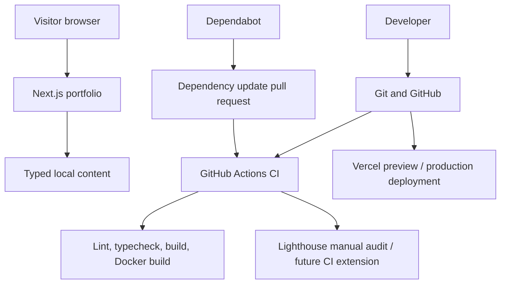

# Maaz Ahmed — Portfolio

A responsive personal portfolio built with Next.js App Router, React, TypeScript and Tailwind CSS. The repository also demonstrates containerized delivery and continuous integration.

> **Content integrity:** project descriptions and experience entries are intentionally cautious. Verify exact dates, certificate names, implementation details and repository URLs before treating them as final. Certificates are not published until verified.

## Features

- Responsive homepage and project directory with search/category filtering
- Individual project pages and status labels
- Light/dark theme preference
- About, skills, experience, education, certificates and contact pages
- Contact form that prepares an email in the visitor's default email app; no server stores messages
- Metadata, sitemap and robots rules
- Docker multi-stage production image and Docker Compose
- GitHub Actions CI and Dependabot updates
- Accessibility focus styles and reduced-motion support

## Requirements

- Node.js 22 LTS (or a supported compatible Node.js version)
- npm
- Docker Desktop / Docker Engine for container workflows

## Local development

```bash
cp .env.example .env.local
npm ci
npm run dev
```

Open http://localhost:3000. On Windows, create `.env.local` by copying `.env.example` in File Explorer or PowerShell if `cp` is unavailable.

## Quality checks

```bash
npm run lint
npm run typecheck
npm run build
npm start
```

Run Lighthouse in Chrome DevTools against the production server at `http://localhost:3000`. Audit representative routes such as `/`, `/projects`, `/projects/healthpulse` and `/contact`. Record the device profile, Lighthouse version and scores when reporting results; scores vary by environment.

## Docker

Build and start the production container:

```bash
docker compose up --build -d
```

Visit http://localhost:3000. Inspect logs and stop the service with:

```bash
docker compose logs -f portfolio
docker compose down
```

The image uses Next.js standalone output and runs as a non-root user. The Compose setup does not include a database because the current version uses version-controlled content and has no database-backed admin dashboard.

## GitHub Actions and Dependabot

`.github/workflows/ci.yml` runs on pushes and pull requests targeting `main`. It installs locked dependencies, runs lint/type checks, builds the app and validates the Docker image. `.github/dependabot.yml` checks npm and GitHub Actions dependencies on a schedule. Review update pull requests before merging them.

## Vercel deployment

1. Push this repository to GitHub.
2. Import the repository in Vercel and keep the detected Next.js framework settings.
3. Set `NEXT_PUBLIC_SITE_URL` to the actual deployed URL (for example, the Vercel project URL).
4. Deploy and verify the home, project, contact, sitemap and robots routes.
5. Use Vercel's Git integration for preview and production deployments. Production should follow reviewed changes merged to `main`.

Docker is provided for reproducible local/portable container deployment; Vercel's native Next.js build is the recommended primary hosting path.

## Architecture



## Security notes

- Do not commit `.env.local`, API keys, tokens or credentials.
- `.env.example` contains placeholders only.
- CI uses read-only repository permissions.
- The current contact form uses a `mailto:` flow; it does not submit personal data to a server.
- There is no admin dashboard or authentication in this release. Do not imply otherwise.
- Before adding server-side email, analytics, uploads or a database, add server-side validation, rate limiting, access policies and secret management.

## Known limitations / roadmap

- Add verified certificate records and credential URLs.
- Replace provisional project wording with verified implementation details, screenshots and repository/demo links.
- Consider a server-backed contact provider if needed, with spam protection and rate limiting.
- Add automated browser tests and Lighthouse CI once the basic build has been verified in the target environment.
- Add a private admin dashboard only alongside secure authentication and authorization.

## License

No license has been selected yet. Add a license only after deciding how you want others to reuse the source.

## Private portfolio dashboard (added)

The private dashboard is available at `/admin`. It supports project records, progress updates, tasks/roadmap items, skills, learning milestones, deployment notes, and importing recent public GitHub events as draft progress entries. Entries are private by default; check **Publish publicly** only for work you want visitors to see. Publicly published projects appear in the Projects page's additional-projects section, while published updates, milestones and deployment notes appear in the homepage build log.

### Configure persistent storage and admin access

1. Create a Supabase project.
2. In Supabase **SQL Editor**, run `supabase/schema.sql`.
3. Copy `.env.example` to `.env.local` and set:
   - `ADMIN_PASSWORD`: a unique, long password used only for this dashboard.
   - `ADMIN_SESSION_SECRET`: a random secret of at least 32 characters.
   - `SUPABASE_URL`: the Supabase project URL.
   - `SUPABASE_SERVICE_ROLE_KEY`: the server-side service-role key from Supabase project API settings. **Never use a `NEXT_PUBLIC_` prefix for this key and never commit it.**
   - `GITHUB_USERNAME`: your GitHub username (defaults to `ahmedmaazmohammed21` in the route if omitted).
4. Start locally with `npm ci` then `npm run dev`; open `http://localhost:3000/admin`.
5. Add an entry, keep it private, and save. Publish it only after checking the content and links.
6. Set the same environment variables in Vercel **Project → Settings → Environment Variables** for Preview/Production as appropriate, then redeploy after changes.

The database is accessed only from server-side route handlers using the Supabase service-role key. The browser never receives that key. Admin authentication uses an HTTP-only, SameSite=Strict cookie signed with `ADMIN_SESSION_SECRET`; the admin route is excluded from search indexing. Keep the password and secret private, use HTTPS in production, and rotate them if exposed.

### Data behavior and limits

- Manual entries are persisted in Supabase and public pages fetch published entries on the server, so publishing does not require editing/redeploying the code.
- GitHub import reads recent **public** GitHub events. It does not monitor private repositories, guarantee a complete commit history, or automatically publish events. Select an event to turn it into a draft and review it before publishing.
- Tasks and skills are private unless explicitly published; only project/update/milestone/deployment records are shown publicly.
- Existing hand-authored portfolio content remains in `content/data.ts`; new dashboard projects are added alongside it. The dashboard does not rewrite existing static project records.
- If Supabase is not configured, the public site continues to render its static content; the admin dashboard reports a configuration error when you try to save records.
